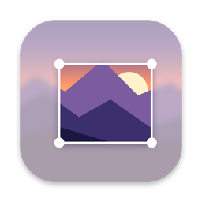
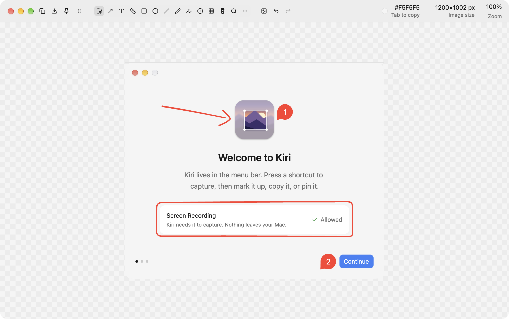

<p align="center">
  
</p>

<h1 align="center">Kiri</h1>

<p align="center">
  An open-source screenshot tool for macOS, written in Rust and drawn on the GPU.
</p>

<p align="center">
  <a href="https://github.com/Moltenship/kiri/releases"></a>
  
  <a href="LICENSE"></a>
</p>

<p align="center">
  <a href="https://github.com/Moltenship/kiri/releases"><b>Download</b></a>
  ·
  <a href="docs/user/README.md">User guide</a>
  ·
  <a href="CHANGELOG.md">Changelog</a>
</p>

<br>

<p align="center">
  
</p>

Kiri captures an area, a window, a screen, or a page that scrolls, and opens it in an editor for arrows, text, blur, and measurements. Press ⇧⌘2, drag, then press Esc, and the image is on the clipboard.

> [!NOTE]
> Kiri is in beta. Please [open an issue](https://github.com/Moltenship/kiri/issues) when something breaks.

## Kiri and Shottr

Kiri is an open-source alternative to [Shottr](https://shottr.cc/), and most of its ideas come from there. Shottr has years of polish that Kiri doesn't have yet. If you want the most polished screenshot tool for the Mac, you should probably use Shottr instead, and [buy a license](https://shottr.cc/) to support its author.

## Install

1. Download `Kiri.dmg` from the [releases page](https://github.com/Moltenship/kiri/releases).
2. Open it and drag Kiri to Applications.
3. Open it. The welcome window asks for Screen Recording, then lets you pick the capture shortcuts and the appearance.

Kiri then lives in the menu bar. Scrolling capture asks for Accessibility the first time you use it.

Kiri needs macOS 15.2 or later on Apple Silicon. When a new release is out, a red dot appears on the menu bar icon, and its menu installs the update.

## Shortcuts

| Action | Default |
| --- | --- |
| Capture Area | ⇧⌘2 |
| Capture Screen | ⇧⌘1 |
| Recognize Text or QR | ⌃⌥⌘O |

The welcome window and Settings → Hotkeys can move Capture Screen and Capture Area to ⇧⌘3 and ⇧⌘4, and Kiri turns those two off in macOS. Settings → Hotkeys gives every other action a shortcut too.

## What it does

- **Capture.** An area, a screen, a window, a delayed shot, or a scrolling page. The area selection can freeze the screen, and window captures can sit on your wallpaper or on transparency.
- **Edit.** Arrows, text, shapes, pen, highlighter, counters, blur, spotlight, and magnifier. Crop to the pixel, trim to the content, and add a backdrop.
- **Measure.** Hold `1` or `2` to measure the distance between edges. Tab copies the color under the cursor.
- **Recognize.** Copy the text or QR code from any area. Recognition runs on your Mac.
- **Pin.** Float a screenshot above every window. A pin can be see-through and click-through.
- **Automate.** `kiri --capture area --then copy,save` runs a capture from a script, Shortcuts, or a launcher.

The [user guide](docs/user/README.md) covers every hotkey and setting.

## Privacy

Kiri has no account, no cloud, and no telemetry. Its only network request is the daily update check against GitHub.

## Build from source

You need a recent stable Rust and Xcode.

```sh
cargo build --release
./target/release/kiri
```

A bare binary is enough for development. It runs as Kiri Dev, with its own settings and menu bar icon, beside an installed Kiri. `scripts/release.sh` builds the signed and notarized app, as [docs/operations/release.md](docs/operations/release.md) describes.

## Contributing

[docs/feature-map.md](docs/feature-map.md) lists what Kiri builds and in what order.

## License

[MIT](LICENSE)
