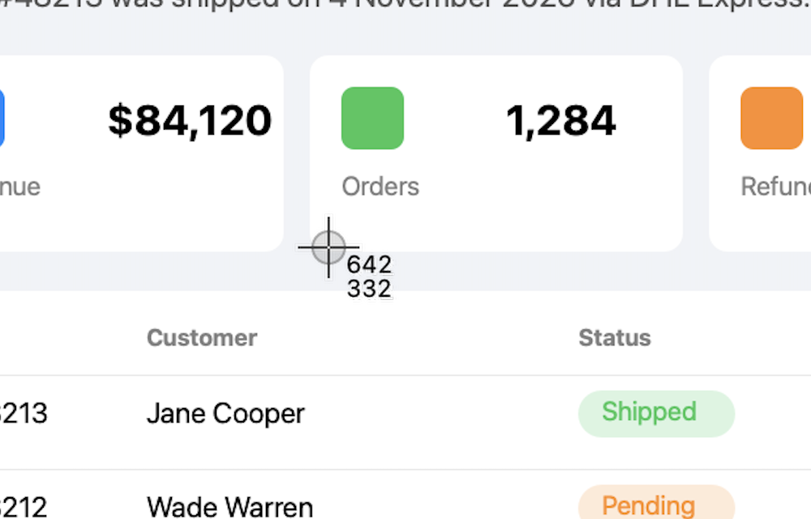
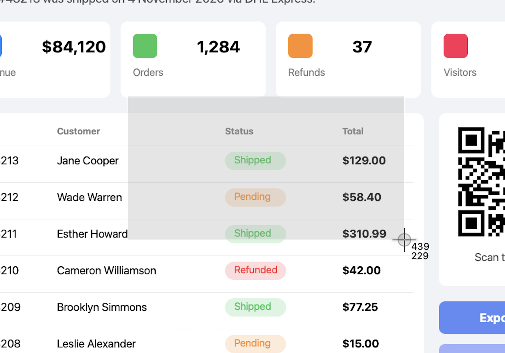
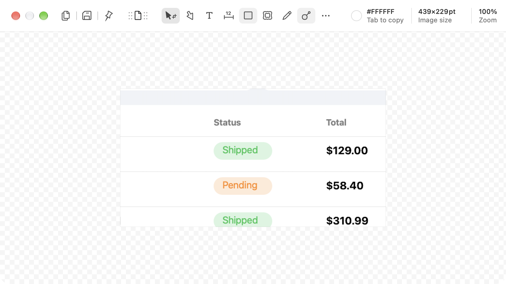

# Area capture

**Shottr default hotkey:** ⇧⌘4 · **Related:** [Repeat area](#repeat-area-capture), [Editor](../07-editor/feature.md)

## What it does

The main capture mode. The screen freezes, the cursor turns into a crosshair, and the user drags a rectangle. On release, the area opens in the editor (or a thumbnail, see [06](../06-after-capture-preview/feature.md)).

## Shottr behavior (observed)

- The screen is frozen, not live: what you select is what was on screen when you pressed the hotkey. Menus and tooltips that were open stay in the shot.
- The crosshair cursor shows the **live cursor position in points** next to it (`642 / 332`).
- While dragging, the selection is drawn as a light overlay, and the label next to the cursor switches to the **selection size** (`439 / 229`).
- Releasing the mouse finishes the capture. `Esc` cancels.
- The captured image keeps full Retina resolution. The editor reports size in points (`439×229pt`).
- Needs macOS Screen Recording permission. On first use Shottr shows "Shottr needs permission to record the screen".
- With "Default zoom level: Prefer 100%" on, an area capture opens the editor at 100% when it fits.

### Repeat area capture

Captures the same rectangle as the last area capture, with no overlay. If there was no earlier area capture, Shottr says: "Repeat Area Capture takes a screenshot of the previously captured area. You need to perform the area capture first." It has its own hotkey slot (unassigned by default).

## Screenshots

| Crosshair with coordinates | Dragging with live size | Result in editor |
|---|---|---|
|  |  |  |
