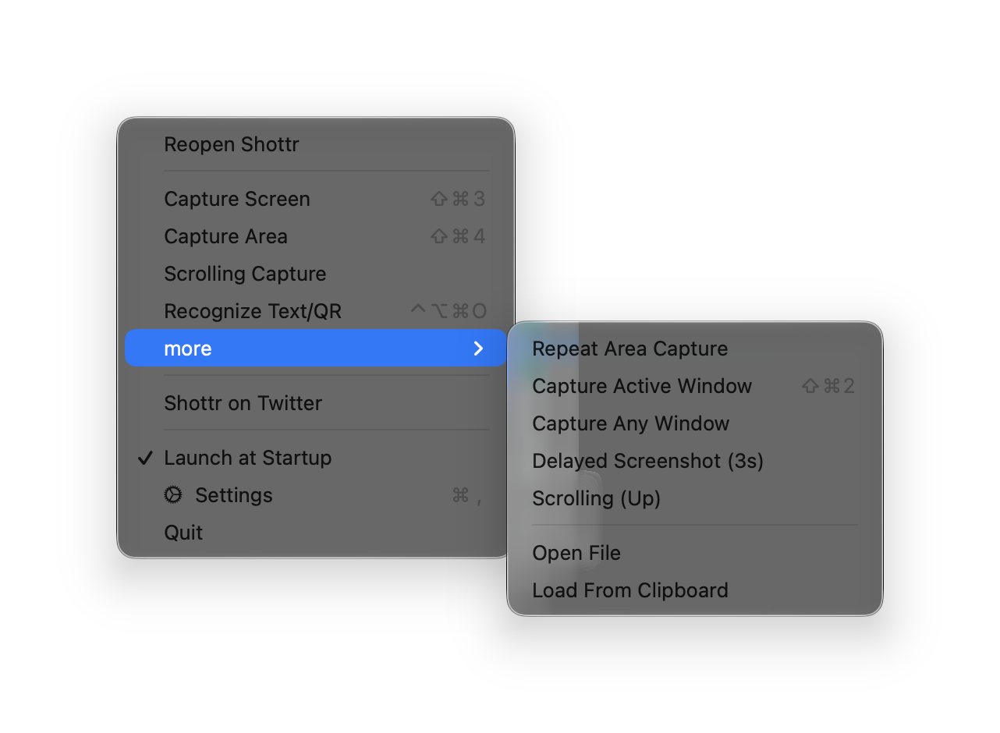

# Fullscreen and delayed capture

**Shottr default hotkey:** ⇧⌘3 (fullscreen) · **Related:** [Area capture](../01-area-capture/feature.md)

## What it does

- **Fullscreen screenshot:** captures the whole display at once, with no overlay.
- **Delayed screenshot (3s):** waits 3 seconds, then captures fullscreen. Useful for hover states, open menus, and tooltips.

## Shottr behavior (observed)

- Both are in the menu bar menu (Capture Screen in the main list, Delayed Screenshot (3s) under **more**). Only fullscreen has a hotkey by default.
- With "Prefer 100%" on, a fullscreen capture opens the editor at 80% zoom.
- Repeat Area Capture, Capture Active Window, Capture Any Window, Scrolling (Up), Open File, and Load From Clipboard are also under **more**.

## Screenshots

