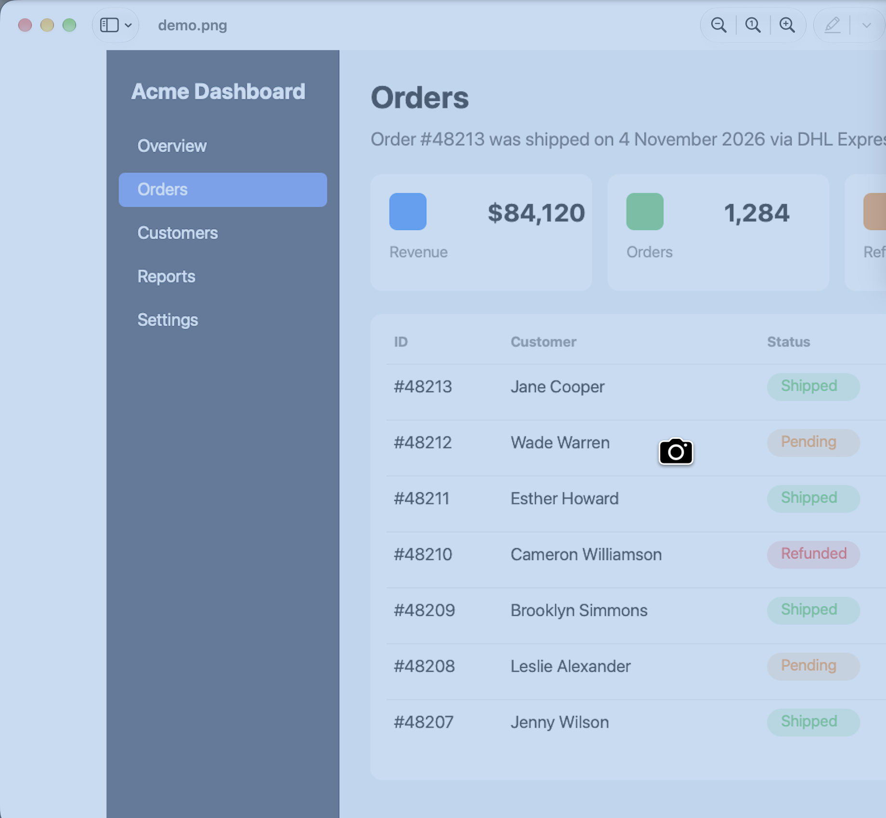
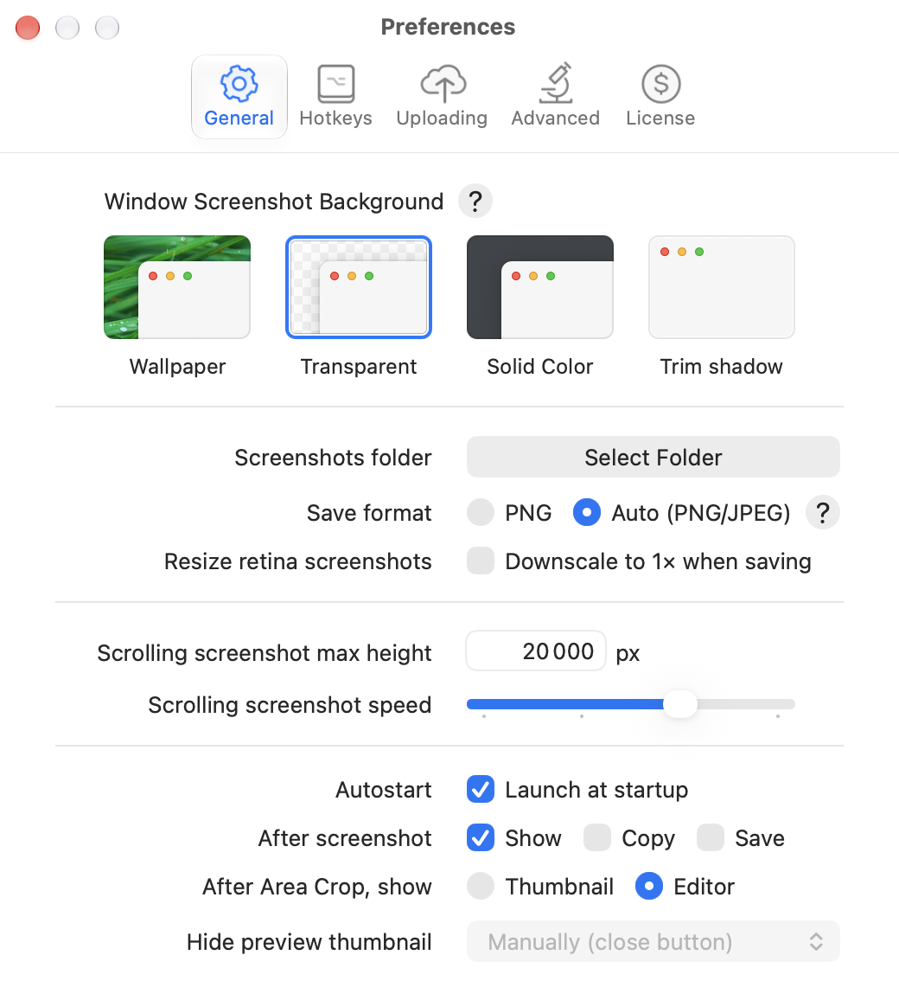

# Window capture

**Shottr default hotkey:** ⇧⌘2 (active window); Any Window has no default hotkey

## What it does

Captures a single window cleanly, without the content behind it, optionally with its shadow and a chosen background.

- **Capture Any Window:** an overlay highlights the window under the cursor (blue tint) and the cursor turns into a camera. Click to capture.
- **Capture Active Window:** captures the frontmost window immediately, with no overlay.

## Shottr behavior (observed)

- The result keeps the native window shadow on a canvas with padding, so the editor's image size is bigger than the window (`1624×971pt` for a smaller window).
- If no windows are open: "No windows are present, try taking a fullscreen screenshot instead".
- Settings → General → **Window Screenshot Background** controls how the area around the window is filled:
  - **Wallpaper:** the desktop picture behind the window.
  - **Transparent:** alpha background, shadow kept (default in this install).
  - **Solid Color**
  - **Trim shadow:** no shadow, window bounds only.
- That setting applies to Active Window and Any Window captures only, never to area or fullscreen.

## Screenshots

| Window picker (hover highlight, camera cursor) | Result: window with shadow on transparent background |
|---|---|
|  |  |

Background setting (top of General settings):

