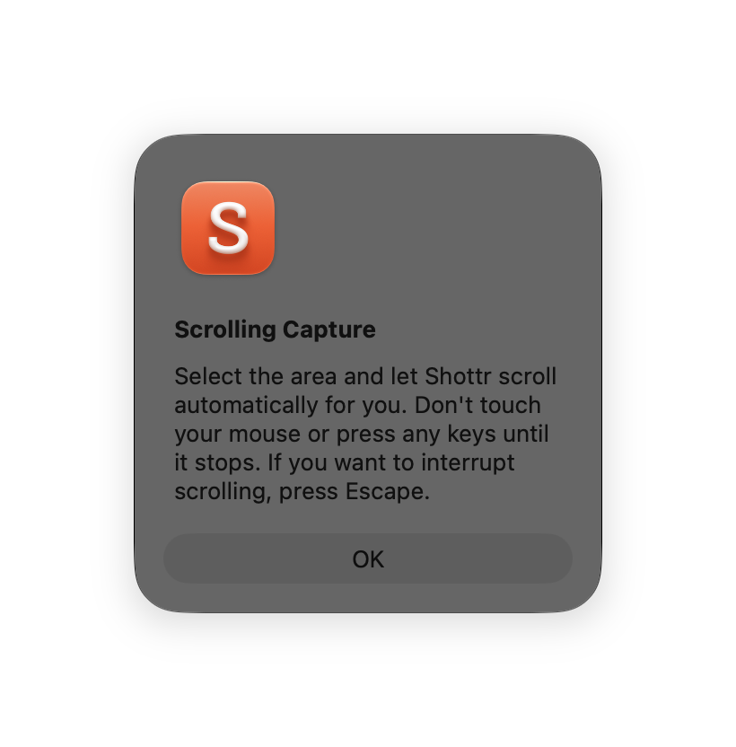
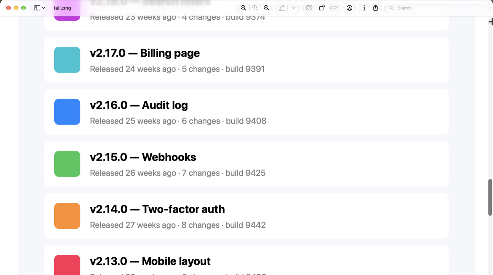
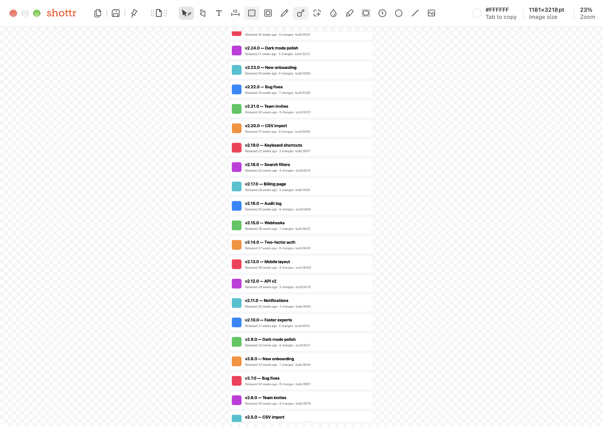

# Scrolling capture

**Shottr hotkey:** unassigned by default · **Menu:** Scrolling Capture, more → Scrolling (Up)

## What it does

Captures content taller than the screen (a web page, chat, list, or document). The user selects an area, the app scrolls the content under it automatically, and the frames are stitched into one tall image.

## Shottr behavior (observed)

1. The first run shows an intro dialog: "Select the area and let Shottr scroll automatically for you. Don't touch your mouse or press any keys until it stops. If you want to interrupt scrolling, press Escape."
2. It needs **Accessibility** permission, because it posts scroll events. Without it, macOS shows its "would like to control this Mac" prompt and the capture stops with "Scrolling Capture requires accessibility permissions".
3. The user drags an area. This is the system selection UI: Shottr runs `screencapture -i -s` (checked in the process list).
4. Shottr scrolls the content and grabs overlapping frames until the content stops moving or the max height is reached.
5. The stitched result opens in the editor. In the test, a 1180 pt wide list became `1181×3218pt`.

Settings and variants:
- **Scrolling screenshot max height:** 20 000 px by default ("Max height reached" when hit).
- **Scrolling screenshot speed:** a slider.
- **Reverse scroll direction** (Advanced), for apps like Mos or Scroll Reverser that invert scrolling.
- **Scrolling (Up):** scrolls upward instead of downward. Deep link `shottr://grab/scrolling/reverse`.
- **Manual scrolling capture:** the user scrolls by hand and Shottr stitches (hidden setting, URL scheme `settings/scrolling/manual/enable`).
- Frames are aligned with Vision's translational image registration. From the binary, unverified.
- Errors: "Shottr wasn't able to scroll", "The images should overlap", plus a hint to try manual mode or reverse direction.

## Screenshots

| Intro dialog | Auto-scrolling in progress | Stitched result in editor |
|---|---|---|
|  |  |  |
