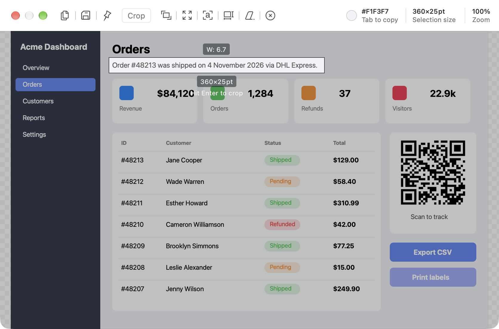
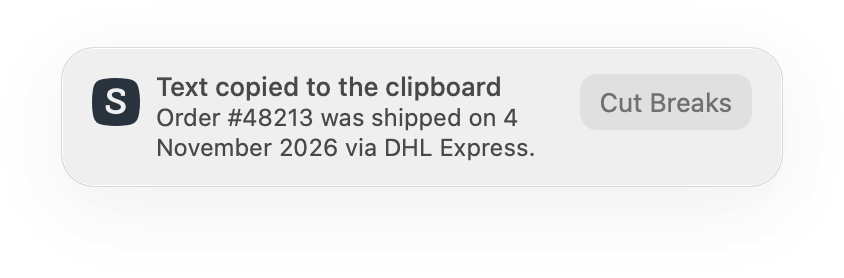
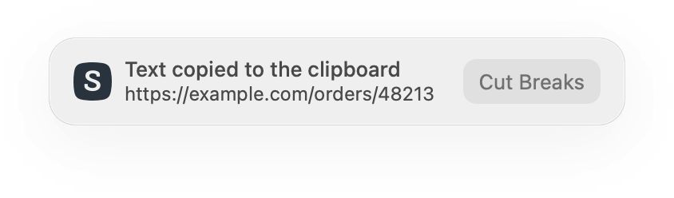

# Text and QR recognition (OCR)

**Shottr hotkeys:** ⌃⌥⌘O (instant, from screen) · ⌘O (in editor, on a selection)

## What it does

Turns pixels into text. Select a region, and the recognized text (or a decoded QR code) goes to the clipboard.

Two entry points:
- **Instant Text/QR Recognition:** a global hotkey opens an area overlay ("Select rectangle with text that you want to recognize and copy"). No editor opens.
- **In the editor:** make a selection, then click **Recognize Text or QR** in the selection toolbar (⌘O). It also appears as an action on the [thumbnail](../06-after-capture-preview/feature.md).

## Shottr behavior (observed)

- The result is copied immediately, and a custom notification shows "Text copied to the clipboard" with a preview of the text.
- The notification has a **Cut Breaks** button that re-copies the text without line breaks ("Text without line breaks copied").
- A QR code inside the selection is decoded, and its payload (a URL in the test) is copied instead of OCR text.
- After OCR from the editor, the editor closed. It's a "grab text and go" flow.
- Settings → Advanced:
  - **Primary OCR language:** a dropdown (`English+` default; long language list incl. CJK, Arabic, Norwegian variants).
  - **OCR line breaks:** "Remove line breaks" as the default behavior.
- Errors: "No text detected", "OCR: Area is too large", "OCR is not ready yet". On the first run after an OS update, the system model may need a minute.

## Screenshots

| Selection over text | Text copied notification | QR payload copied |
|---|---|---|
|  |  |  |
