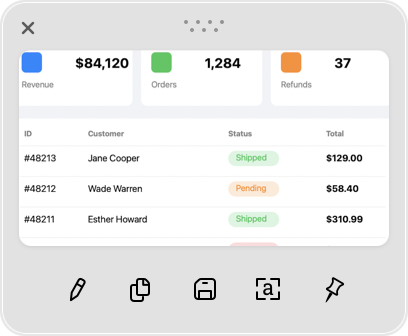

# After-capture preview

**Settings:** General → After screenshot / After Area Crop, show / Hide preview thumbnail

## What it does

Decides what happens right after a capture. Options: open the full editor, show a small floating thumbnail with quick actions, and/or copy or save automatically.

## Shottr behavior (observed)

Settings → General:
- **After screenshot:** `Show`, `Copy`, `Save` checkboxes, combinable. Show + Copy means "open it and it's already in the clipboard".
- **After Area Crop, show:** `Thumbnail` or `Editor`.
- **Hide preview thumbnail:** `Manually (close button)`, or presumably a timeout (the dropdown was disabled in this config).

The thumbnail is a small floating window near the capture:
- A close (×) button and a drag handle (••••) on top. Dragging the image out works like drag-and-drop to other apps.
- Actions at the bottom: **Edit** (opens the editor), **Copy**, **Save**, **Recognize text** ([a]), **Pin** to screen.

Related (Advanced):
- **Action when hiding with Esc:** `Copy Image` and/or `Save Image`. Pressing `Esc` in the editor hides it and copies, which is the fastest flow.
- **Confirmation style:** `Custom Notification` (Shottr's own toast, as in the OCR screenshots) or system notifications.

## Screenshots

