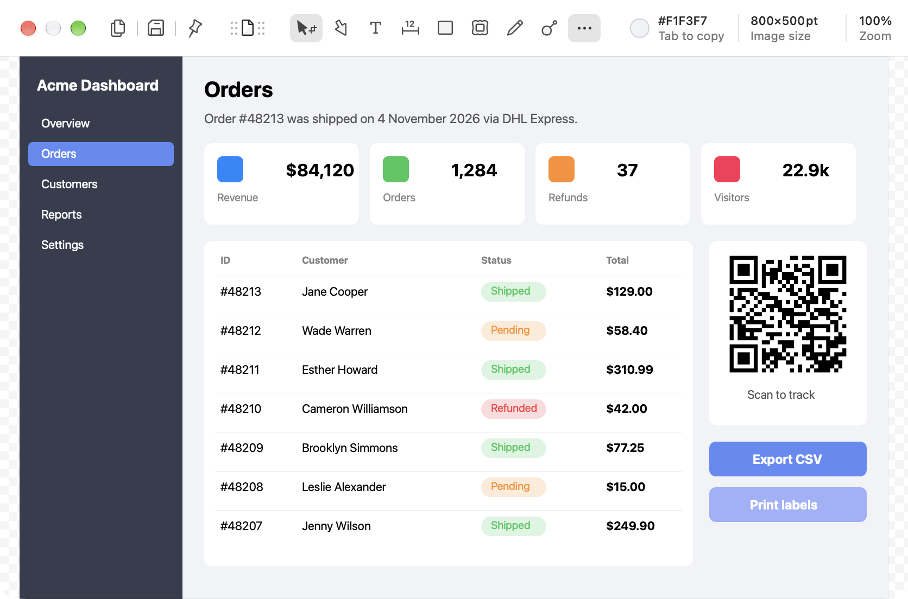
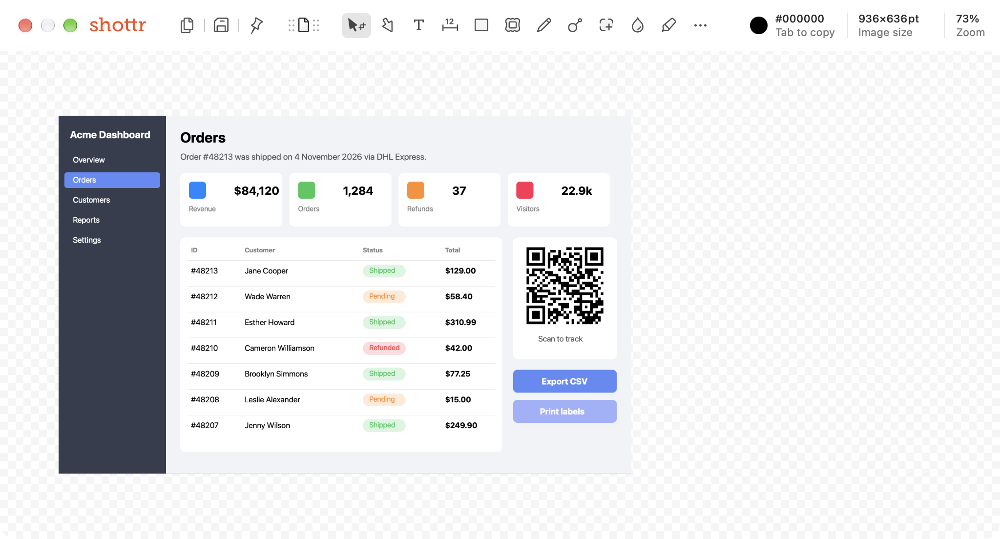
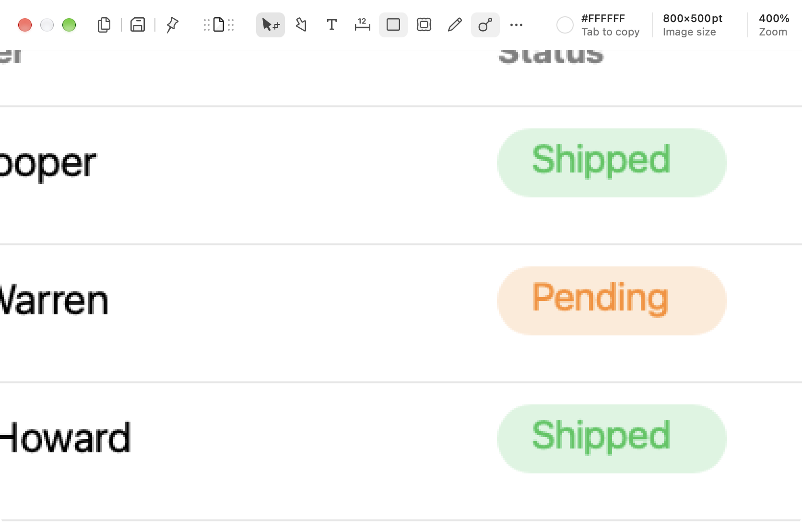

# Editor

## What it does

The window every capture lands in. A canvas with the image, a single-row toolbar, and an info area. All tools from features 08–15 live here.

## Layout (observed)

Toolbar, left to right:

| Group | Items |
|---|---|
| Output | **Copy** (`Esc` or ⇧⌘C), **Save** (⌘S), **Floating Pin** (⌘P), **Drag'n'Drop Image** (drag this handle into another app) |
| Tools | **Crop/Select** (V), **Arrow** (A), **Text** (T), **Ruler** (1 or 2), **Rectangle** (R), **Backdrop** (K), **Freehand Drawing** (D), **Magnifier** (M) |
| Overflow | **More tools (…)**: Add Capture (⌘A), Blur/Erase (B), Highlighter (H), Spotlight (S), Counter (C), Oval (O), Line (L), Paste Image (⌘V) |
| Info | Color under cursor (`#F1F3F7`, "Tab to copy"), Image size (`800×500pt`; with a selection it shows "Selection size"), Zoom (`100%`) |

When the window is wide enough, the overflow tools move onto the toolbar (see `editor-wide-toolbar.png`). Single-letter shortcuts switch tools while the canvas has focus.

Every drawn object is selected after creation and shows a **contextual property bar** at the top right: color, size slider, and style variants for that tool (see [annotations](../09-annotations/feature.md)).

## Menus (macOS menu bar)

- **File:** Copy Image ⇧⌘C, Save Image ⌘S, Save Image As ⇧⌘S, Pin to Screen ⌘P, Print ⇧⌘P, Open File ⇧⌘O, Open From Clipboard ⇧⌘V, Close ⌘W, Close All ⌥⌘W. Upload Image ⌘E is out of scope.
- **Edit:** Undo ⌘Z, Redo ⇧⌘Z, **Reset Crop**, **Rasterize (Merge) Image** (flattens objects into pixels).
- **Draw:** every tool, plus **Snap to Objects** and **Snap to Similar Objects**.
- **Zoom:** Zoom In ⌘+, Zoom Out ⌘−, Zoom To Fit ⌘1, Zoom To 100% ⌘0, Zoom To Selection ⌘2, Selection Top Left / Bottom Right (jump the viewport to selection corners), Enter Full Screen.

## Behavior

- Annotations stay editable objects until saved or rasterized. Undo and redo cover both objects and pixel operations.
- Drawing past the image edge grows the canvas, and the export includes it. See [canvas growth](../09-annotations/feature.md#canvas-grows-to-fit-annotations-observed).
- Zoom goes up to at least 400% with crisp pixels at high zoom. The mouse wheel zooms, and Advanced has a reverse-direction option.
- Image size is shown in points by default. Clicking it switches between PX and PT ("Click to switch PX/PT").
- The app also opens PNG, JPEG, and GIF files (document types), and images from the clipboard.
- Save format: **PNG** or **Auto (PNG/JPEG)** (JPEG for photo-like content). **Downscale to 1× when saving** for Retina shots. Shottr retries with fallbacks if a save fails.
- The default folder is chosen in settings. Saving goes there without a dialog. Save As asks.
- Advanced: **Main window: Always on top**.

## Screenshots

| Editor (default width) | Wide window: all tools in the toolbar |
|---|---|
|  |  |

| More tools menu | Zoom 400% |
|---|---|
|  |  |
