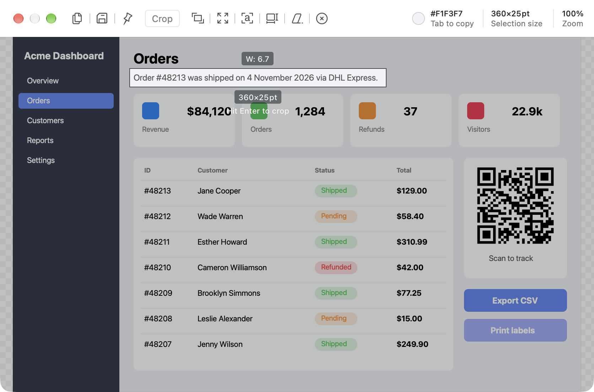
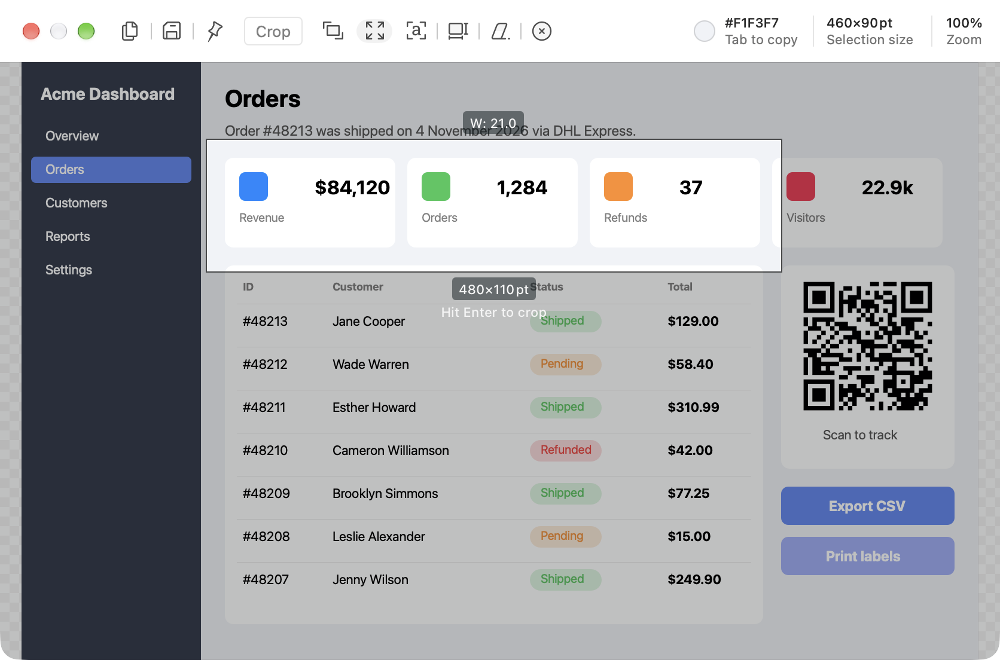
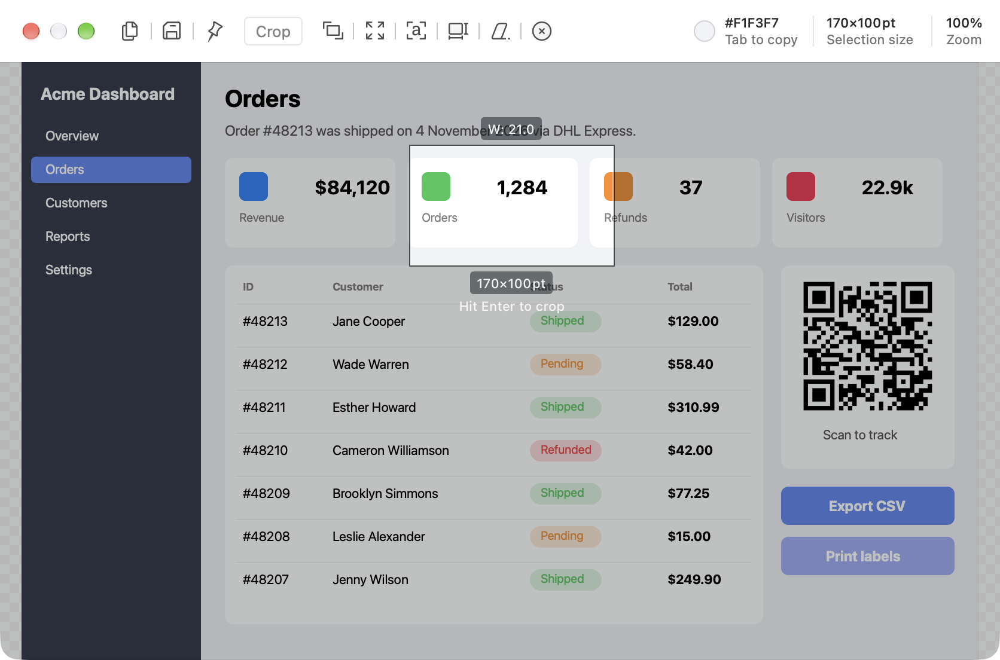
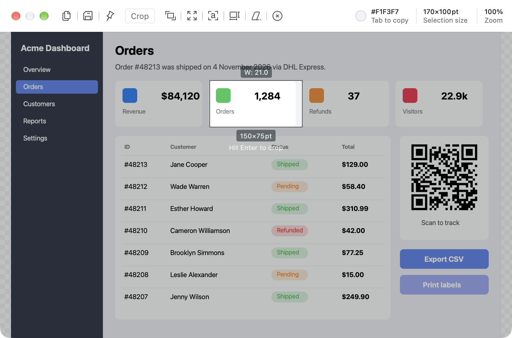
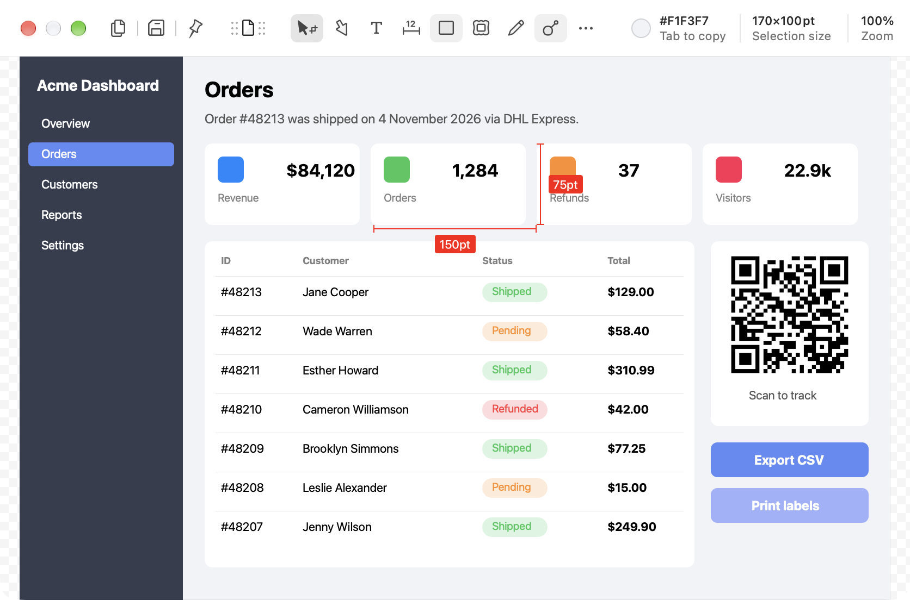
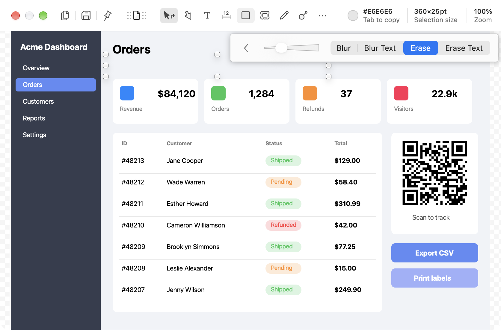

# Crop and selection

**Tool:** Crop/Select (V)

## What it does

Dragging on the canvas with the Crop/Select tool creates a selection. The rest of the image dims, and the toolbar swaps to selection actions. `Enter` crops to the selection.

## Shottr behavior (observed)

On-canvas, while a selection exists:
- Everything outside it dims by about 25% black, and a 1 pt dark outline sits just outside its edge.
- It has no visible handles: dragging an edge or a corner resizes it (`200×80` → `240×80`).
- A size label centered under the selection (`460×90pt`) on a dark pill, and under it the hint **"Hit Enter to crop"** in plain white text.
- A label above it, such as `W: 20.8`: the WCAG contrast ratio of the selection's two main colors (black text on white gives about 21).
- The info area shows **Selection size** instead of Image size.

The selection toolbar replaces the tool row:

| Action | Shortcut | Effect |
|---|---|---|
| **Crop** | `Enter` | Crop the image to the selection. Edit → Reset Crop restores it (non-destructive crop). |
| **Autoadjust** | A | Shrinks the selection to the content boundaries, e.g., snaps to a card's edges (`170×100` → `150×75`). |
| **Resize** | ⇧+] | Grows the selection by a fixed step on each side (`460×90` → `480×110`). Presumably ⇧+[ shrinks it. |
| **Recognize Text or QR** | ⌘O | OCR on the selection ([05](../05-text-and-qr-recognition/feature.md)). |
| **Imprint Selection Size** | none | Draws dimension lines with px/pt labels (`150pt`, `75pt`) into the image as annotation objects. Good for design specs. |
| **Erase** | Del | Fills the selection with the surrounding background, removing the content ([10](../10-blur-and-erase/feature.md)). |
| **Reset Selection** | `Esc` | Drops the selection. |

⌘C with an active selection copies just the selection, drops it, and keeps the editor open. Without a selection, ⌘C copies the image and closes the editor.

`Option`+drag shows a thin blue rectangle at the autoadjusted bounds while dragging, and the selection snaps to it on release (`153×60` → `102×49`).

From the binary, not seen in the UI:
- A **Cut Out** button exists in the selection toolbar's nib but doesn't show in 1.9.3 (the toolbar has the 7 buttons above). It may be a gated Vision subject cut-out.

## Screenshots

| Selection with size and "Hit Enter to crop" | Resize (grow) |
|---|---|
|  |  |

| Autoadjust: before | Autoadjust: after (snapped to card) | Imprint selection size |
|---|---|---|
|  |  |  |

Erase applied to a text line:

