# Annotations

## What it does

Vector objects drawn over the screenshot. Each one stays editable (move, resize, restyle, delete) until export or rasterize.

## Shared behavior (observed)

- Pick a tool from the toolbar, the Draw menu, or its single-letter shortcut, then drag on the canvas.
- A new object stays selected with handles, and a **property bar** appears at the top right of the canvas:
  - `<` collapses the bar.
  - The **color swatch** opens a palette of 8 presets (red, purple, yellow, pink, teal, blue, navy, cream) plus **Custom**. Custom colors need a license in Shottr.
  - The **size slider** sets stroke width or font size. The tapered track shows thin → thick.
  - **Style variants** depend on the tool (below).
- Draw → **Snap to Objects** / **Snap to Similar Objects** aligns new objects to existing ones and matches sizes.
- From the binary, unverified: `Option`-drag duplicates an object, ⌘C/⌘V copy and paste objects, holding ⌘ or `Shift` skips snapping, and `Shift` constrains angles and proportions.

## Tools

| Tool | Key | Variants and notes |
|---|---|---|
| **Arrow** | A | 4 styles: outlined, filled bold (default), thin, double-headed. A middle handle bends the arrow into a curve. |
| **Text** | T | Two styles: text on a solid color label (default) or plain text. Click to place and type in place. The binary also has a "goofy" handwritten font (Noteworthy Bold) and a callout pointer (unverified). |
| **Rectangle** | R | Outline, filled, hatched/pattern, solid. Square or rounded corners. In the binary the fills are hand-drawn, transparent, translucent, and opaque. Rectangle, oval, spotlight, and magnifier share one shape model, so a rectangle can turn into an oval. |
| **Oval** | O | Same fill styles as the rectangle. |
| **Line** | L | Plain line, with a style menu (…). Solid or dashed. ⌘-clicking an end cycles its cap (from the binary, unverified). |
| **Freehand Drawing** | D | Pen. Three variants: **free stroke**, **rectangle**, **oval**. The oval variant reshapes the drawn stroke into a hand-drawn-looking ellipse. On a stroke that is already rectangular, the rectangle variant looks almost the same as the free one (verify). The variant can be switched after drawing, while the stroke is selected. |
| **Highlighter** | H | Semi-transparent marker rectangle (yellow by default) that keeps the text under it readable. In the binary it is a freehand stroke with multiply blending and its own pastel palette: `#ADF6FF #C2EAFE #E6E6FF #FFDAEF #FFF68D #F2FE01 #D8FF55 #DDF5C6`. |
| **Counter** | C | Click to drop numbered badges 1, 2, 3… The number goes up on each click. Good for step-by-step guides. Arrow keys change a badge's pointer angle (from the binary, unverified). |

Magnifier and Spotlight are in [11](../11-spotlight-and-magnifier/feature.md), and Blur/Erase in [10](../10-blur-and-erase/feature.md).

## Canvas grows to fit annotations (observed)

Annotations can go past the edge of the screenshot. The canvas grows to fit them, so an arrow can point at something from outside the image.

- **Size rule:** once any object crosses the image edge, the canvas becomes the bounding box of the image and all objects, **plus ~20pt padding on all four sides**. That includes sides that no object touches. Measured three times:
  - arrow 80pt past the right edge and 40pt above the top: 800×500 → 920×580
  - rectangle 70pt past the left edge and 45pt below the bottom: 911×585
  - arrow and freehand together: 1020×624
- **Grows on release, not live:** while dragging, the part of a stroke outside the current canvas is clipped. The canvas grows when the mouse button is released (see GIF).
- **Shrinks back:** moving the object back inside the image, or undoing it, returns the canvas to the original size. The size is recomputed from object bounds, not accumulated. The "Image size" label updates on the next mouse move.
- **Fill:** the new area is one flat color picked from the image's dominant background: `#F3F5F8` in the demo, even next to the dark `#464E5F` sidebar. It is not an edge-pixel stretch, and it is not transparent. Internal names hint at this: `expandableCanvas`, `bestCanvasColor`, `canvasLimitH/V`. Those last two suggest the growth has a cap.
- **Export:** Copy/Save output the expanded canvas with the fill (911×585pt → 1821×1170 px @2x).
- The color picker reads only the original pixels. Over the added area it shows `#000000`.
- **Zoom:** the view can't zoom out below fit. On a window that fits the image exactly, the margin around the image is tiny. The window has to be larger than the image before there is room to draw outside it.
- A crop selection is clamped to the current canvas bounds.

## Screenshots

| Arrow (curvable, 4 styles) | Text on label | Color palette |
|---|---|---|
| 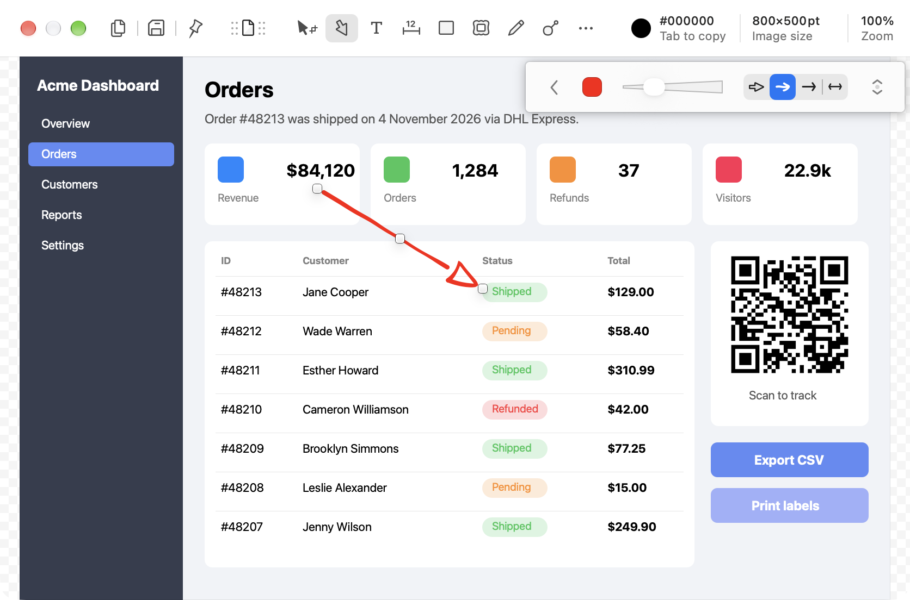 | 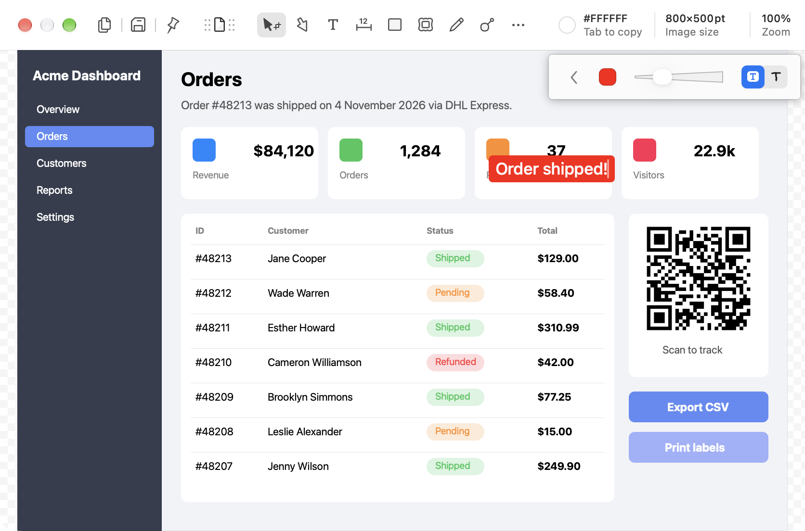 | 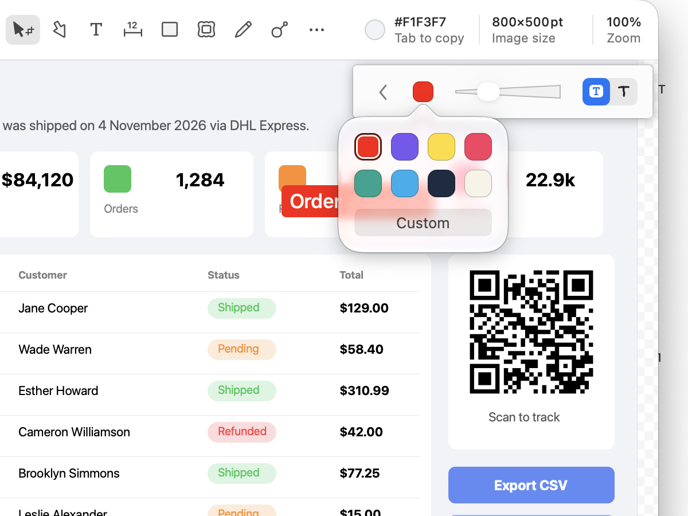 |

| Rectangle | Oval | Line |
|---|---|---|
| 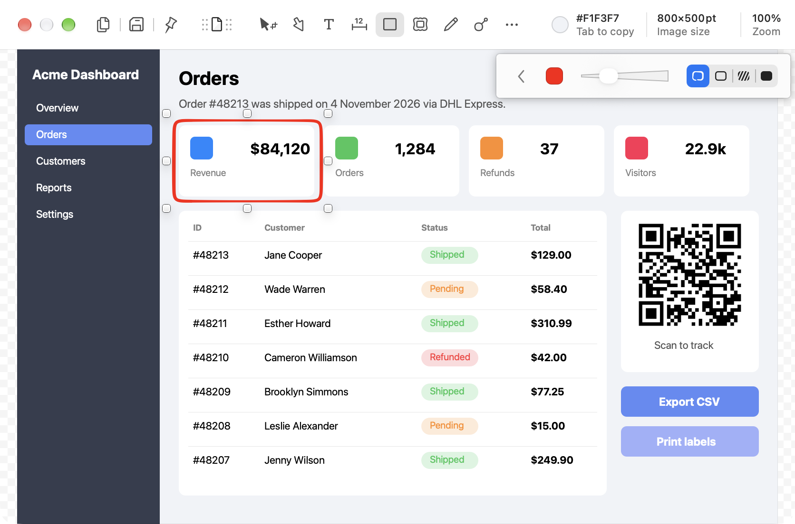 | 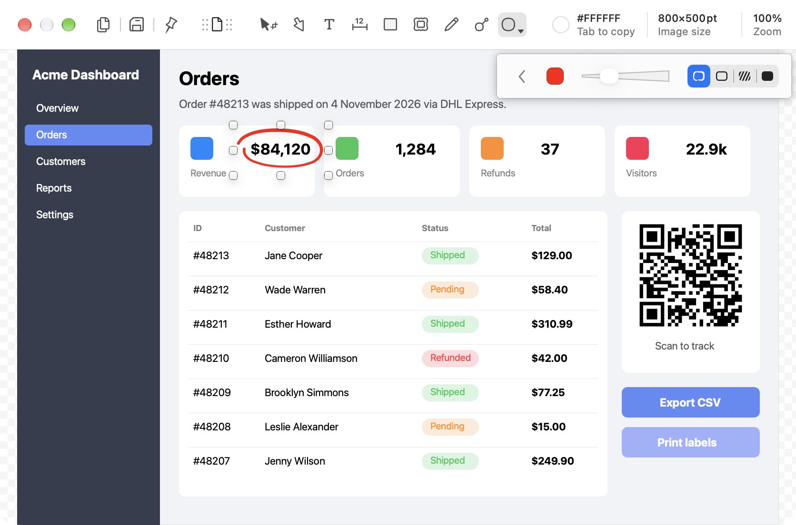 | 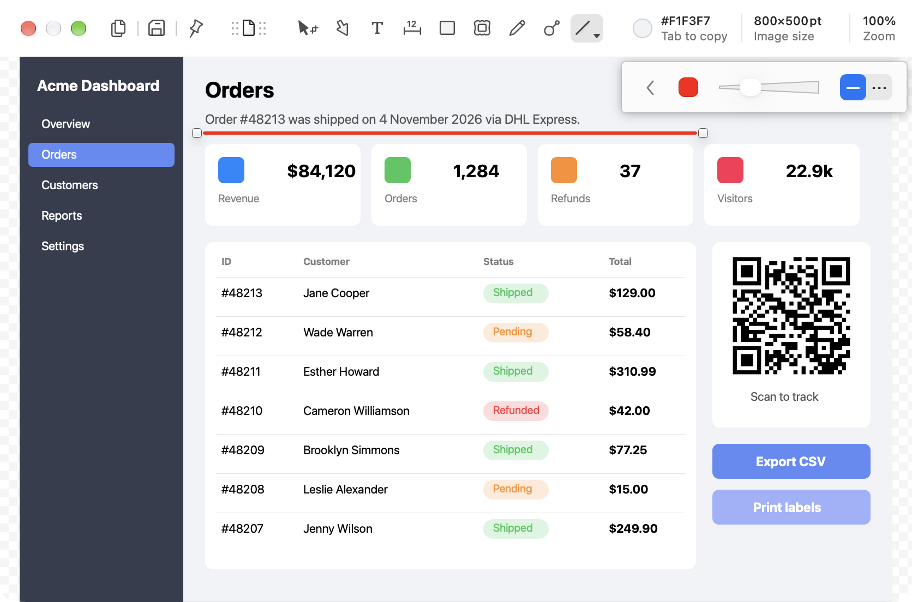 |

| Freehand | Highlighter | Counter |
|---|---|---|
| 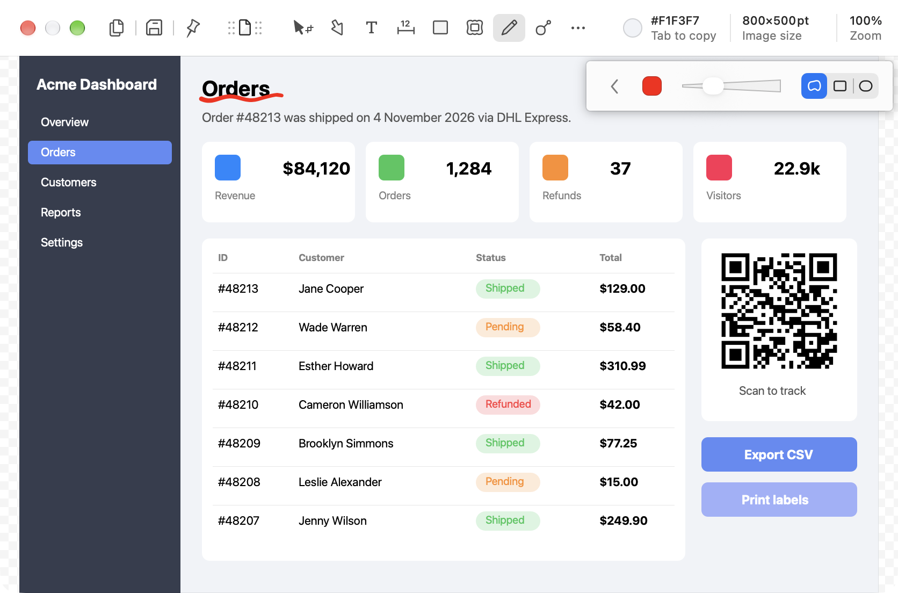 | 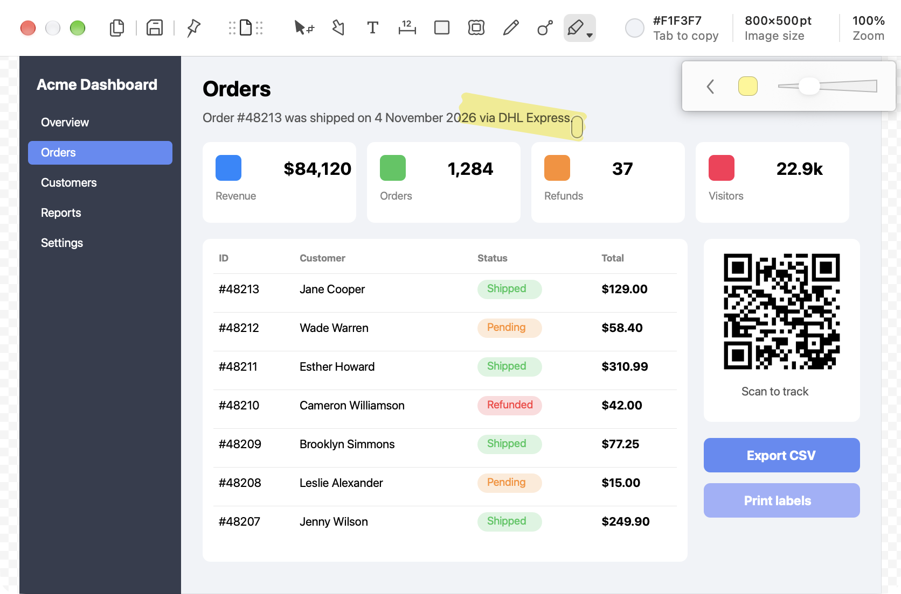 | 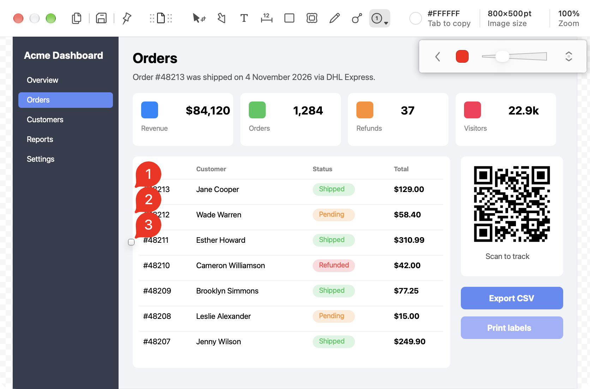 |

Freehand variants on the same stroke (free · rectangle · oval):

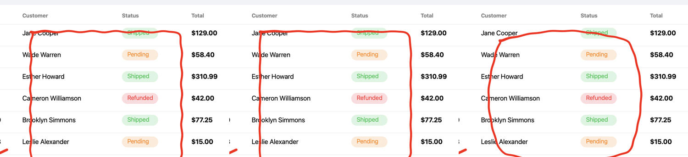

Canvas growth:

| Arrow past the edge: 800×500 → 920×580 | Arrow moved back inside: 800×500 again |
|---|---|
| 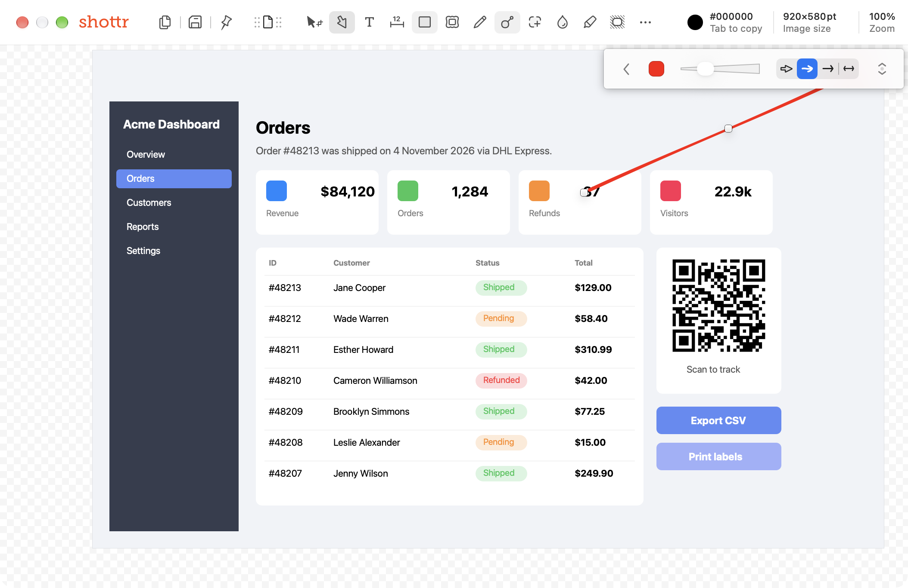 | 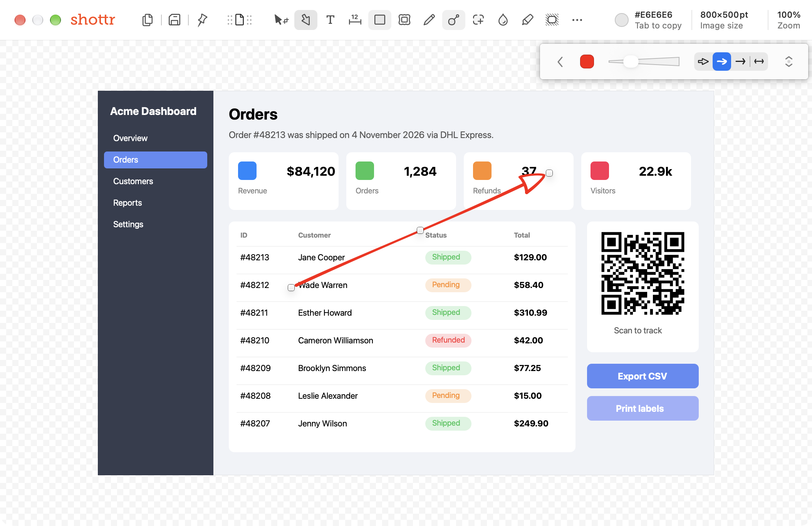 |

| Fill is one background color, even next to the dark sidebar | Copied image includes the grown canvas |
|---|---|
| 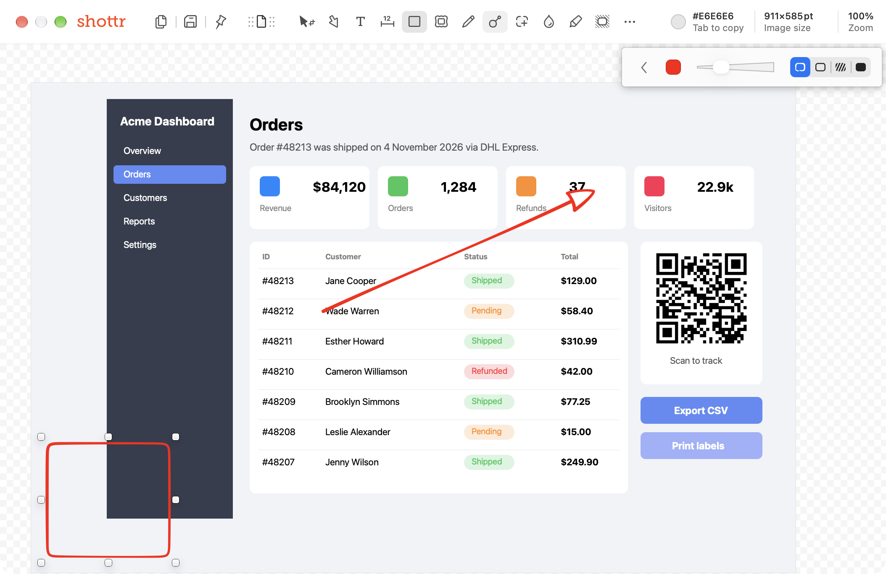 | 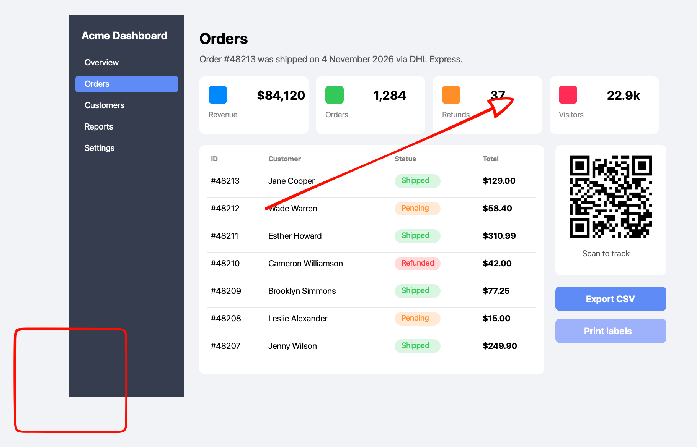 |

Stroke is clipped while dragging, and the canvas grows on release:

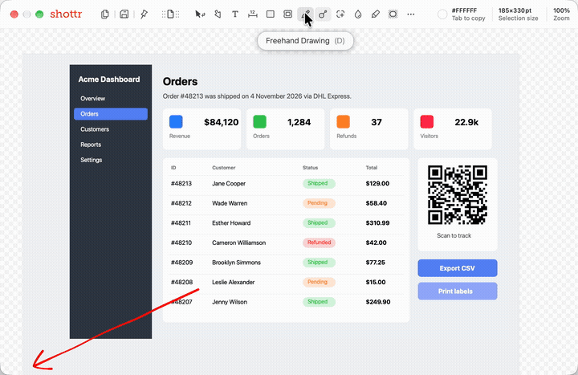
