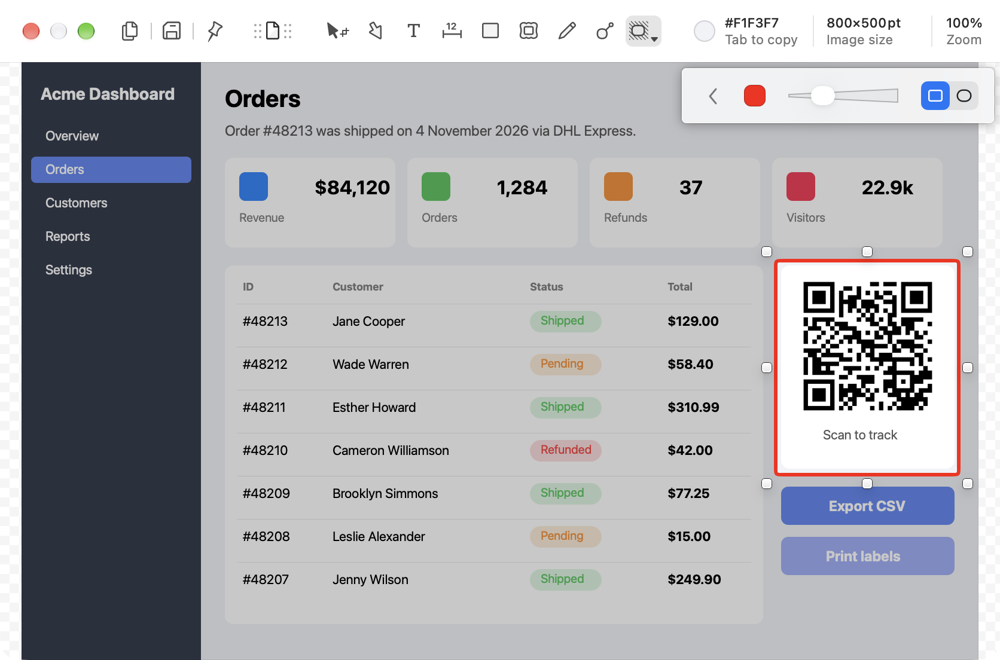
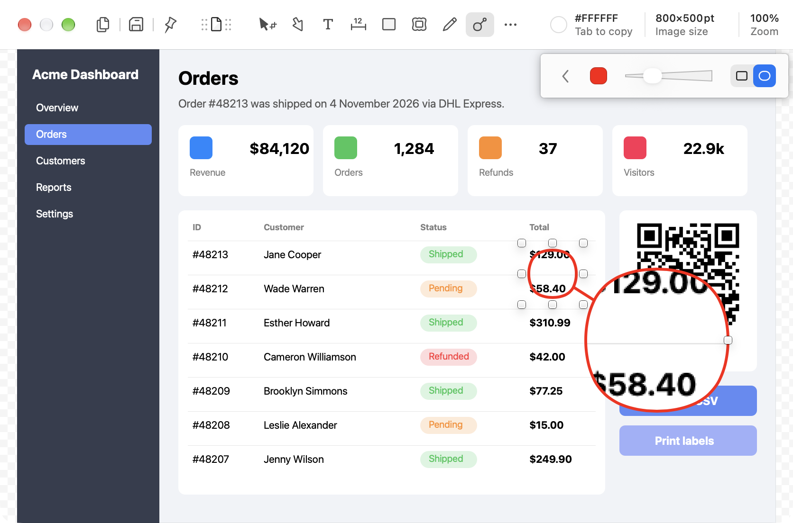

# Spotlight and magnifier

**Tools:** Spotlight (S), Magnifier (M)

## Spotlight

Dims the whole image except the dragged rectangle, which pulls the viewer's eye to one area.

Observed in Shottr:
- Drag a rectangle. Everything outside darkens by about 21% black (white becomes `#C8C8C8`), and the area keeps a colored outline, red and about 2.5 pt by default, with slightly rounded corners.
- Two shape variants: rectangle and ellipse.
- Several spotlights share one overlay: each one is a bright hole in the same dim layer.
- Spotlight lives in the More tools menu. While it is active, the menu button shows the spotlight icon with a ▾ instead of `…`. Pressing `M` with the spotlight active did not switch to the magnifier.

## Magnifier

A circular zoom callout: a small source circle on the image plus a larger circle that shows that area enlarged.

Observed in Shottr:
- The magnifier has its own toolbar button, next to the pen.
- The drag boxes the source: the circle is centered in the dragged box, as wide as its longer side. The lens appears below and to the right of it (about 33° down from horizontal) at 3× the source's size, joined to it by a short straight line on the line between the centers. Default color is red.
- The lens shows exactly what is inside the source circle, nearest-neighbor, so the zoom is the ratio of the two sizes.
- The property bar has color, a **stroke width** slider (not zoom), and two variants: rounded square and round (default). The source, the connector, and the lens share one stroke width. No shadow.
- Selected, the source has 8 box handles that stand off the circle, and the lens has one handle on its right edge.
  - The lens handle resizes the lens around its center, which raises the zoom.
  - A source corner handle resizes the source with the opposite corner fixed. The lens keeps its size, so the zoom drops.
  - Dragging the source moves both circles. Dragging the lens moves only the lens.
- The circles are slightly irregular, hand-drawn style.

## Screenshots

| Spotlight on the QR card | Magnifier on a price |
|---|---|
|  |  |
