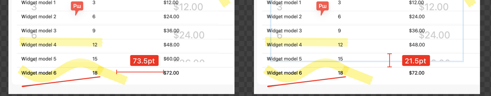

# Ruler

**Shortcut:** hold `1` or `2` and move the mouse

## What it does

Measures distances in a screenshot for design QA: spacing, padding, and element sizes.

## Shottr behavior (observed)

- Clicking the Ruler toolbar button shows a hint instead of switching tools: **"Use the keyboard. Hold ① or ② key, or an arrow key, and move your mouse over the area you want to measure"**, with an animated example (`28px` across a button).
- While the key is held, Shottr finds edges around the cursor and draws a measurement line with a label in px/pt:
  - `1` measures vertically (between the nearest edges above and below the cursor).
  - `2` measures horizontally.
  - Left/right arrows measure horizontally, up/down vertically.
  - Edges are tight: a light row divider on white stops it, and so does the first pixel of a glyph, so `2` between two table cells measures the gap between the texts.
- Releasing the key ends the measurement. Clicking presumably keeps it as an annotation ("Imprint", see [08](../08-crop-and-selection/feature.md)).

## Screenshots

