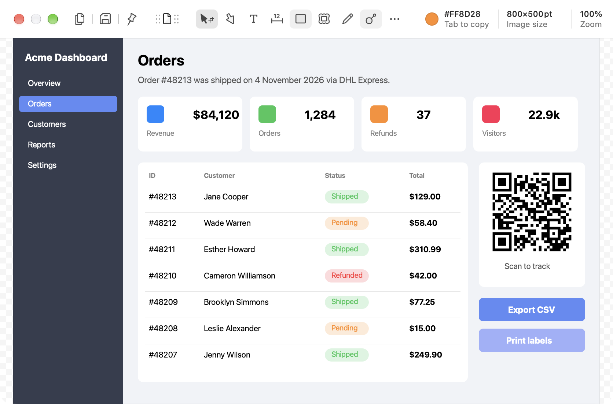
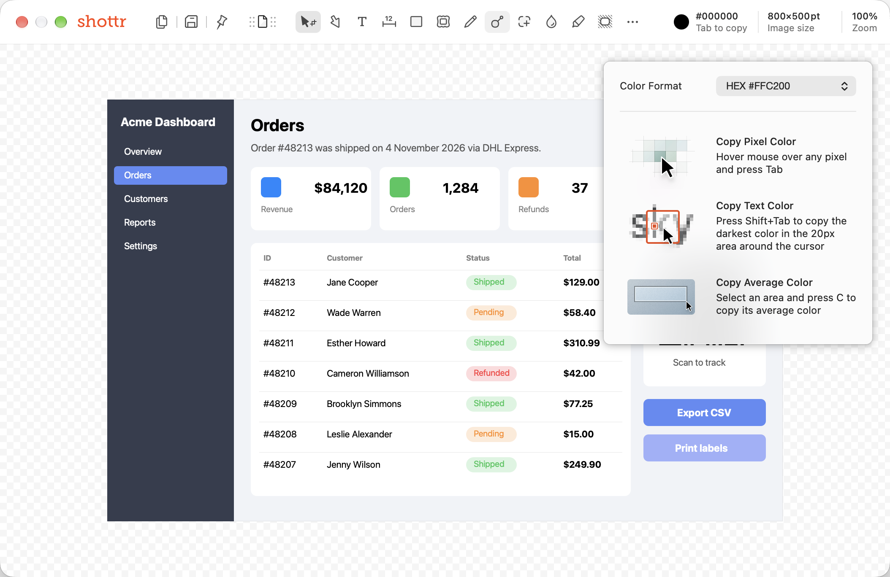
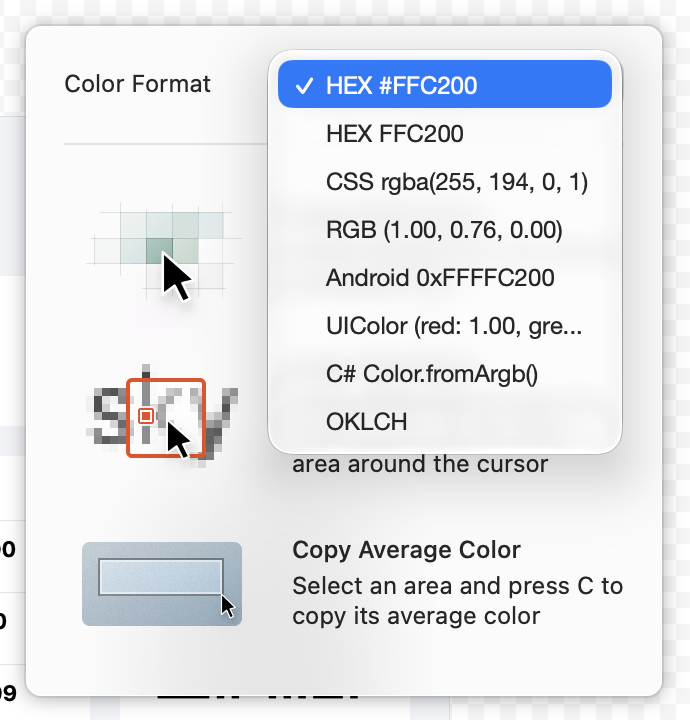

# Color picker

**Shortcut:** `Tab` copies the color under the cursor

## What it does

In the editor, the toolbar always shows the color of the pixel under the cursor. Pressing `Tab` copies it.

## Shottr behavior (observed)

- A swatch plus hex value in the toolbar info area (`#FF8D28` over the orange card), with the hint "Tab to copy".
- Clicking the color readout opens a popover with a **Color Format** dropdown and the three copy modes:
  - **Copy Pixel Color:** hover any pixel and press `Tab`.
  - **Copy Text Color:** `Shift`+`Tab` copies the darkest color in the 20 px around the cursor.
  - **Copy Average Color:** select an area and press `C`.
- Formats: `HEX #FFC200`, `HEX FFC200`, `CSS rgba(255, 194, 0, 1)`, `RGB (1.00, 0.76, 0.00)`, `Android 0xFFFFC200`, `UIColor (red: 1.00, …)`, `C# Color.fromArgb()`, `OKLCH`.
- **Contrast ratio:** with a selection, Shottr can show "WCAG 2.0 Contrast Ratio" for the colors inside it: "W3C accessibility guidelines recommend WCAG contrast ratio of at least 4.5 for regular text and 3.0 for large text and UI elements."
- An "APCA Contrast Ratio" string sits next to the WCAG one (unverified).
- A "Recalculate Global Top Colors" string suggests a dominant-colors summary.

## Screenshots

| Color under cursor | Copy modes | Color formats |
|---|---|---|
|  |  |  |
