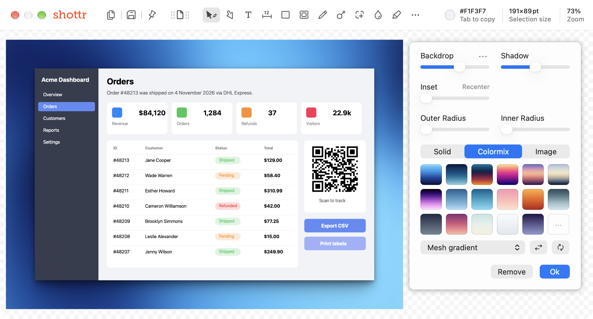
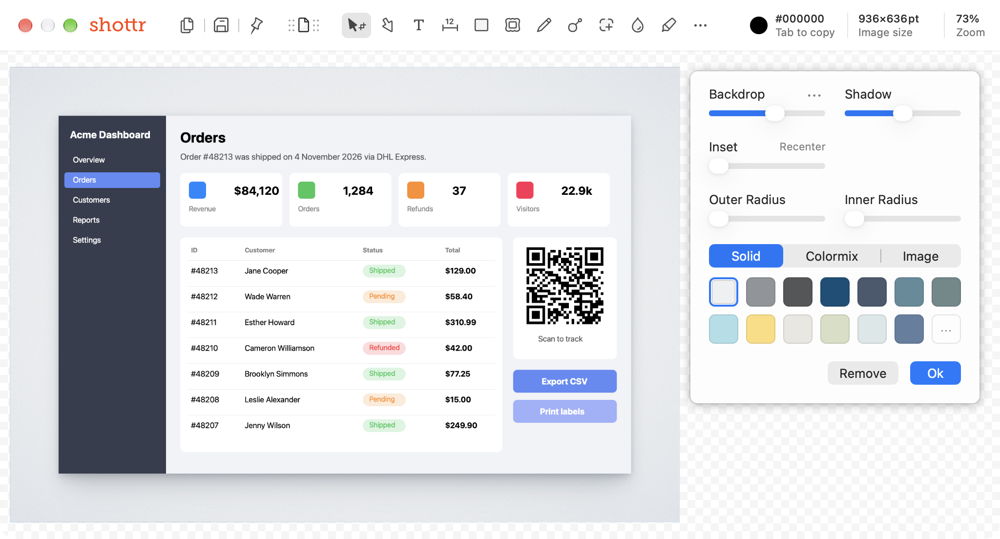
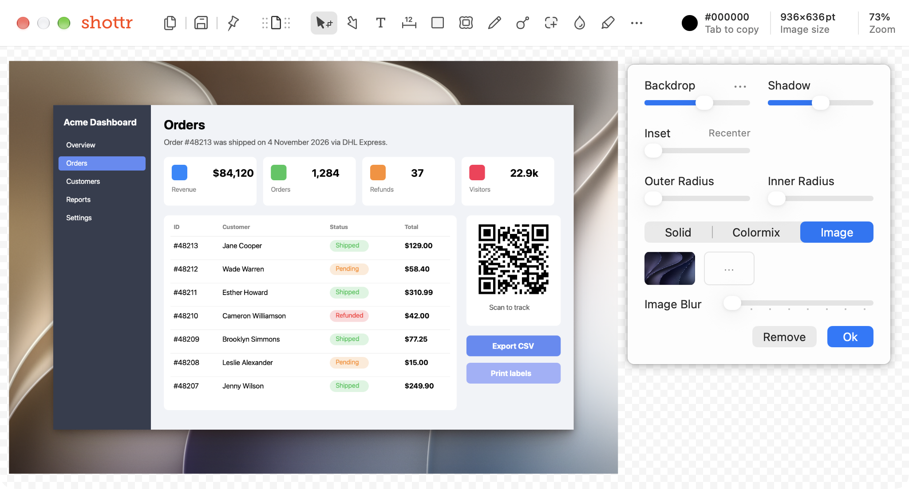
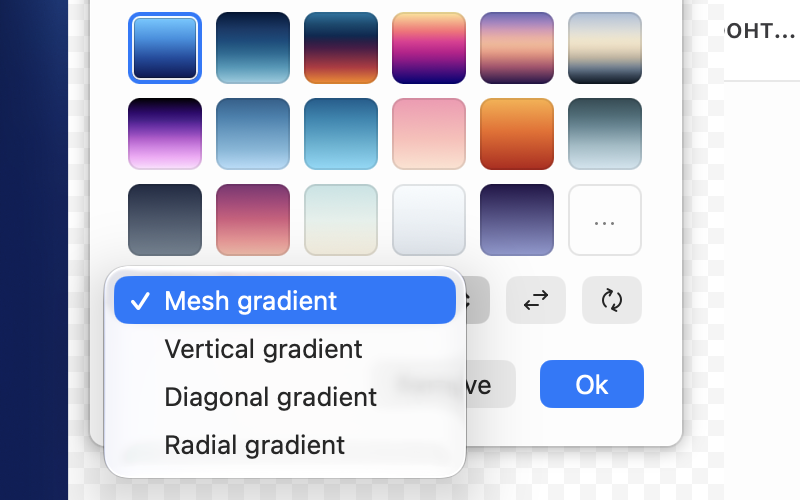

# Backdrop

**Tool:** Backdrop (K)

## What it does

Puts the screenshot on a decorative background with padding, shadow, and rounded corners, ready to share on social media or in docs.

## Shottr behavior (observed)

Backdrop opens a side panel (the editor window widens to fit it) with live preview:

- **Backdrop** slider: padding around the image. A `…` menu has more options.
- **Shadow** slider: drop-shadow strength under the image.
- **Inset** slider: inner padding, with a **Recenter** link.
- **Outer Radius** / **Inner Radius**: corner rounding of the canvas and of the screenshot.
- Background type tabs:
  - **Solid:** 13 preset colors plus a custom `…`.
  - **Colormix:** 17 gradient presets plus custom, a gradient type dropdown (**Mesh**, **Vertical**, **Diagonal**, **Radial**), a swap-direction button, and a randomize button.
  - **Image:** a built-in wallpaper or a custom file (`…`), plus an **Image Blur** slider.
- **Remove** and **Ok** buttons.
- The image size grows to include the backdrop (`800×500` → `936×636pt`).
- Gradient and custom backgrounds are behind a license in Shottr ("Gradient Backdrop is only available after the license activation").

## Screenshots

| Colormix (mesh gradient) | Solid | Image + blur |
|---|---|---|
|  |  |  |

Gradient types:

