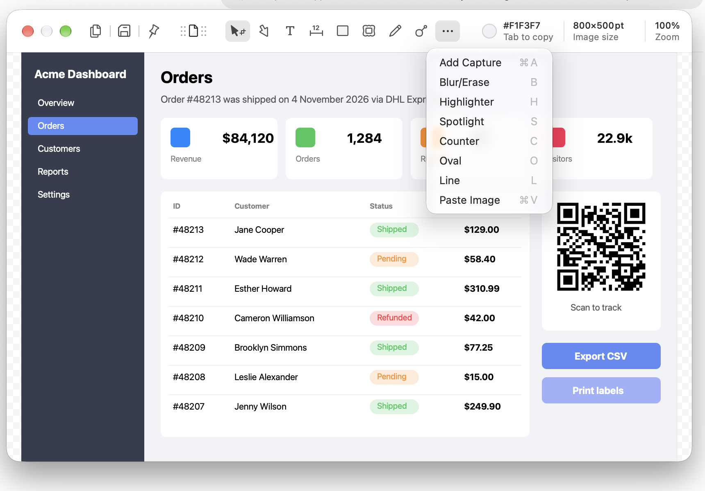

# Compose and GIF

**Tools:** Add Capture (⌘A), Paste Image (⌘V), from the More tools menu

Add Capture wasn't run. Paste Image was observed: the pasted overlay's property bar has a **transparency** button and a **GIF** button. The rest comes from Shottr's menus and in-app strings.

## Add Capture

Takes a new area capture and drops it onto the current canvas as a movable image object. It builds one image from several shots, e.g., two UI states side by side.
- "Take a screenshot before adding a capture to it" if the editor is empty.
- License-gated in Shottr.
- It is also the last tool in the Draw menu bar menu, with no key equivalent there; the menu bar's ⌘A belongs to Edit → Select All.

## Paste Image (image overlay)

Pastes the clipboard image as a layer on top of the screenshot.
- It lands centered, at its own point size.
- The size slider sets a border drawn inside the image edge, about 2 pt by default, with corners rounded about 3 pt. At zero there is no border and the corners are square.
- The transparency mode shows the whole overlay at about 50% opacity.
- Corner handles keep the aspect ratio. Moving the overlay past the image edge grows the canvas live, as annotations do.
- "Image overlay takes the image from the clipboard. Your clipboard doesn't seem to contain an image at this moment."
- A transparency mode helps line up the overlay with the screenshot: "For better result, align overlay and the background using the transparency mode."

## Two-frame GIF

"This feature creates an animation of two alternating frames: the image overlay, and the screenshot under the overlay." Position an overlay over the original, then export a GIF that flips between the two. It's useful for before/after comparisons and visual diffs ("To create GIF with two frames, position overlay image on top of the original screenshot.").

- The GIF button saves a file to the default folder, as Save does. With no default folder set, it first opens the same "Choose default folder" panel.

## Screenshots

