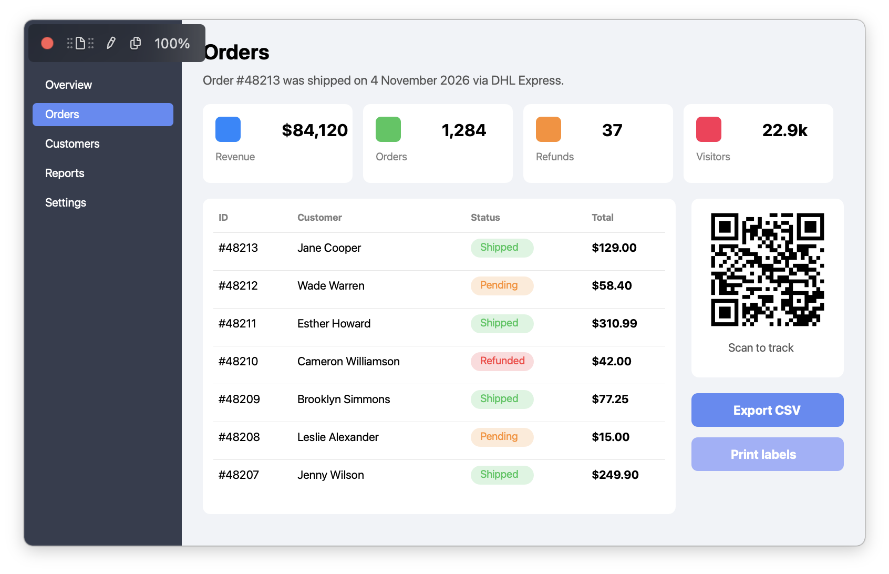
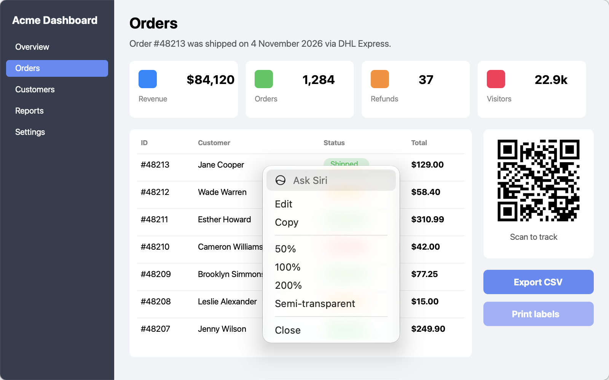

# Floating pin

**Shortcut:** ⌘P (File → Pin to Screen); also on the thumbnail

## What it does

Turns the screenshot into a borderless, always-on-top window. Use it as a reference while you work in another app: copy numbers from it, compare layouts, keep instructions visible.

## Shottr behavior (observed)

- Opens a frameless window with the image at 100%. The editor closes.
- The window floats above normal windows.
- On hover, a small dark toolbar appears in the top-left corner:
  - **Close** (red dot)
  - **Drag'n'drop** handle to drag the image into another app
  - **Edit** (pencil), back to the editor
  - **Copy**
  - **Zoom %** label. Scrolling presumably zooms the pin.
- The window is moved by dragging the image.
- Right-click opens a context menu: **Edit**, **Copy**, **50%**, **100%**, **200%**, **Semi-transparent**, **Close** (plus the system's Ask Siri). Semi-transparent makes the pin see-through.
- The binary has no click-through mode for pins (unverified).

## Screenshots

| Hover toolbar | Context menu |
|---|---|
|  |  |
