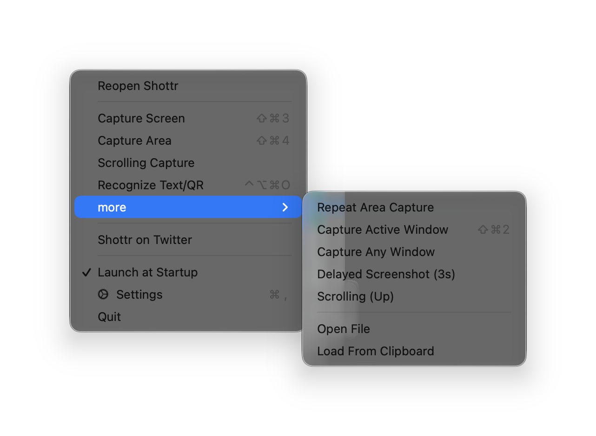
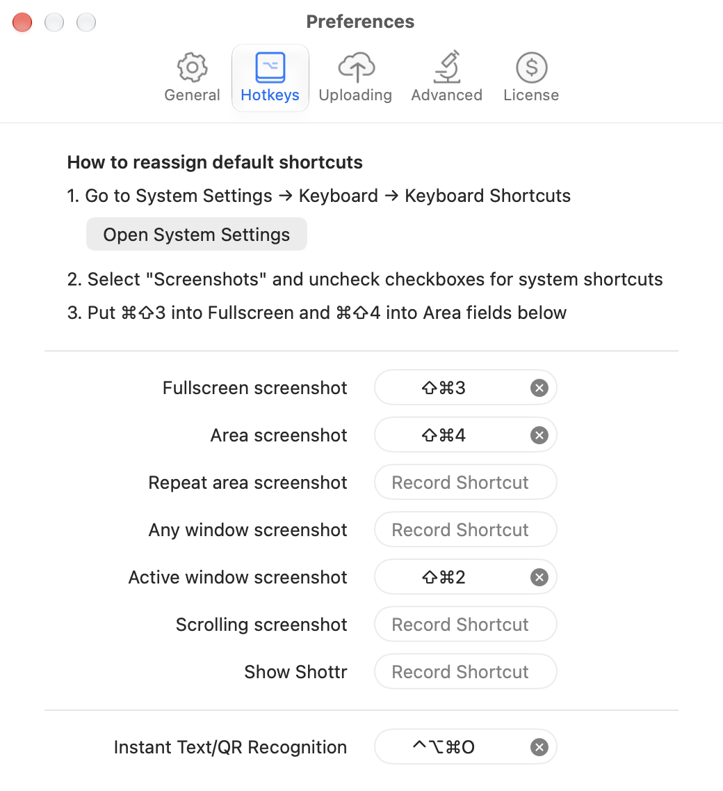

# Menu bar / tray and hotkeys

## Menu bar (tray) menu

Shottr is a menu bar app. Its icon menu (shown when "Hide menubar icon" is off):

- Reopen Shottr (shows the last screenshot)
- **Capture Screen** ⇧⌘3
- **Capture Area** ⇧⌘4
- **Scrolling Capture**
- **Recognize Text/QR** ⌃⌥⌘O
- **more ›** Repeat Area Capture · Capture Active Window ⇧⌘2 · Capture Any Window · Delayed Screenshot (3s) · Scrolling (Up) · Open File · Load From Clipboard
- Shottr on Twitter
- Launch at Startup ✓
- Settings ⌘,
- Quit

Closing the last window keeps the app running in the menu bar. On first close, Shottr explains: "If you quit the app, shortcuts will stop working. If you close the window, dock icon will go away, but the app will stay in the menu bar."

## Global hotkeys

Settings → Hotkeys has one recorder per action, each clearable:

| Action | Default |
|---|---|
| Fullscreen screenshot | ⇧⌘3 |
| Area screenshot | ⇧⌘4 |
| Repeat area screenshot | none |
| Any window screenshot | none |
| Active window screenshot | ⇧⌘2 |
| Scrolling screenshot | none |
| Show Shottr | none |
| Instant Text/QR Recognition | ⌃⌥⌘O |

The tab starts with "How to reassign default shortcuts": 1) open System Settings → Keyboard → Keyboard Shortcuts (with a button), 2) turn off the system Screenshots shortcuts, 3) put ⇧⌘3 and ⇧⌘4 into the Fullscreen and Area fields.

## URL scheme (automation)

`shottr://` deep links are off by default (Advanced → **URL Scheme API: Enable deep links**). When an app calls one while it's off, Shottr asks: "Some app, perhaps on your behalf, tries to execute deep link shottr://… Do you want to enable deep links in Shottr?"

Commands found in the binary: `grab/` with `fullscreen`, `area`, `repeat`, `window`, `window/active`, `scrolling`, `scrollingup`, `scrolling/reverse`, plus `ocr`, `load/clipboard`. There are also settings switches: `settings/scrolling/manual/enable|disable`, `settings/capturecursor/auto|include|exclude`, `settings/library/enable|disable|limit`, and `settings/areacustomgrabber/`. The exact paths need checking against Shottr's docs.

## Screenshots

| Menu bar menu | Hotkeys settings |
|---|---|
|  |  |
