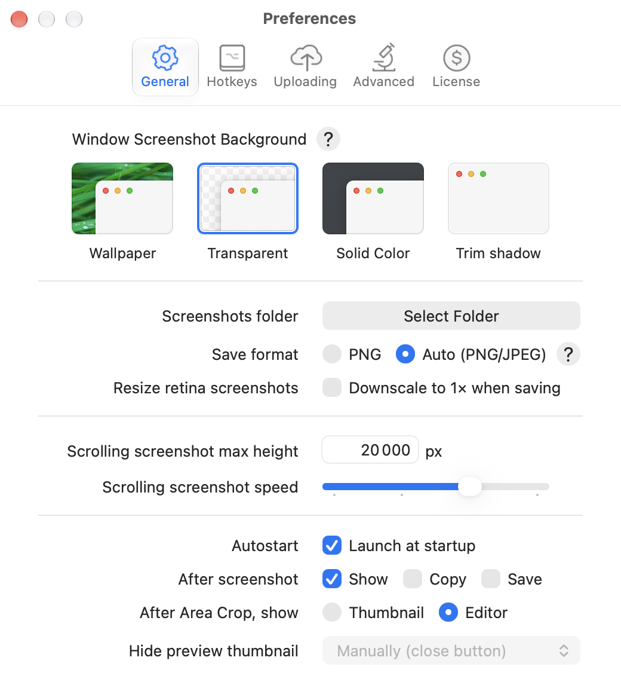
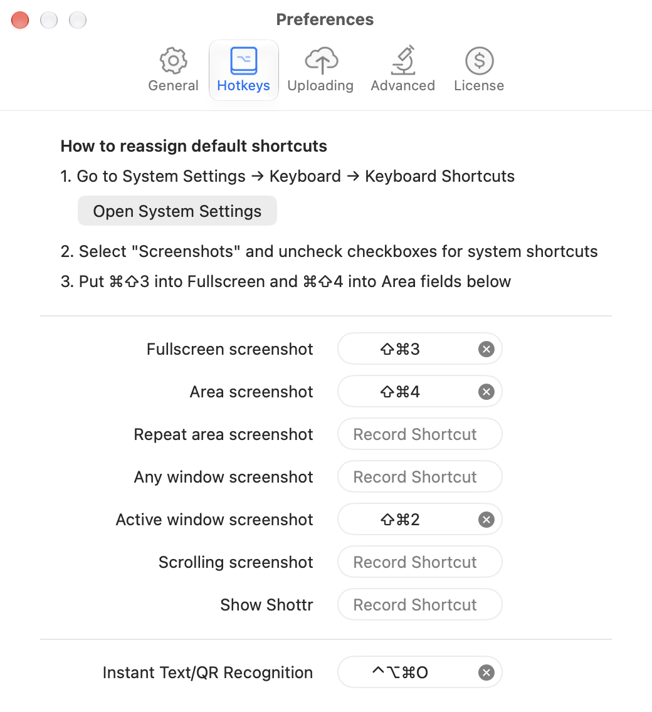
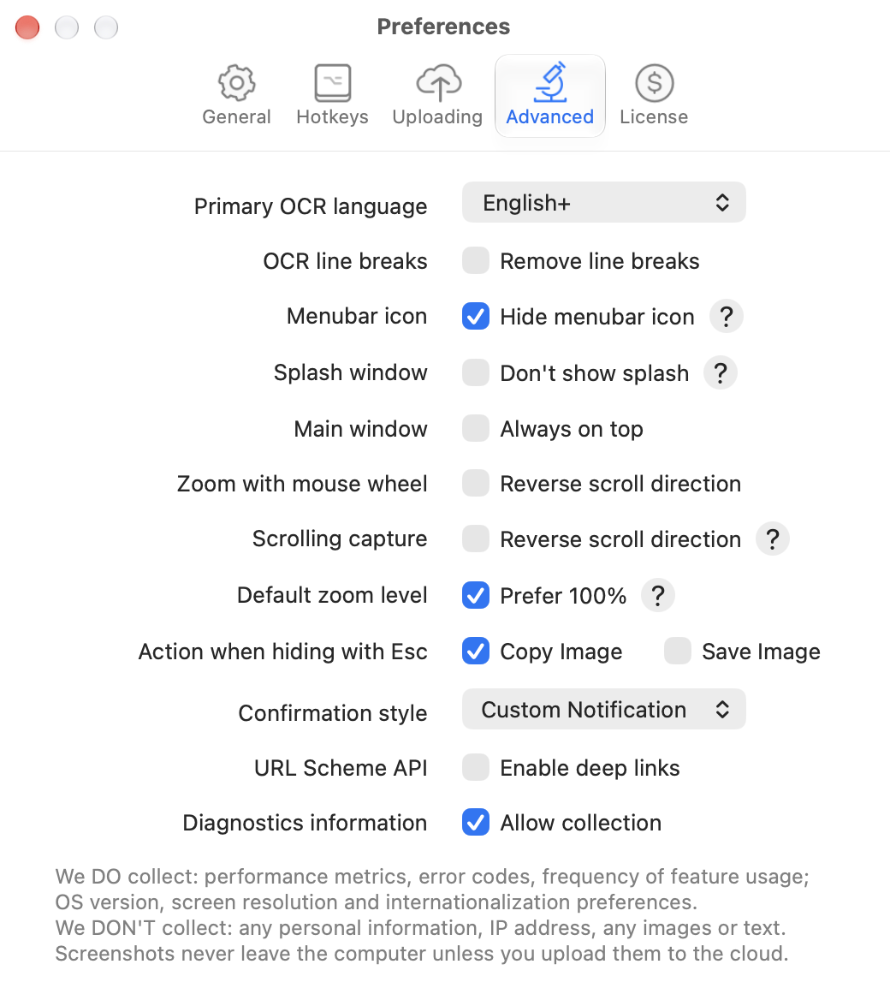

# Settings

Shottr's settings window has five tabs: General, Hotkeys, Uploading, Advanced, License. This page lists every setting.

## General

| Setting | Values (default in this install) |
|---|---|
| Window Screenshot Background ([03](../03-window-capture/feature.md)) | Wallpaper / **Transparent** / Solid Color / Trim shadow |
| Screenshots folder | Select Folder |
| Save format | PNG / **Auto (PNG/JPEG)** |
| Resize retina screenshots | Downscale to 1× when saving (off) |
| Scrolling screenshot max height | **20 000** px |
| Scrolling screenshot speed | slider |
| Autostart | **Launch at startup** |
| After screenshot ([06](../06-after-capture-preview/feature.md)) | **Show** / Copy / Save |
| After Area Crop, show | Thumbnail / **Editor** |
| Hide preview thumbnail | **Manually (close button)** / timeout |

## Hotkeys

See [17](../17-menu-bar-and-hotkeys/feature.md).

## Advanced

| Setting | Values |
|---|---|
| Primary OCR language ([05](../05-text-and-qr-recognition/feature.md)) | **English+**, many others |
| OCR line breaks | Remove line breaks (off) |
| Menubar icon | Hide menubar icon |
| Splash window | Don't show splash |
| Main window | Always on top |
| Zoom with mouse wheel | Reverse scroll direction |
| Scrolling capture | Reverse scroll direction |
| Default zoom level | **Prefer 100%** (area at 100%, fullscreen at 80%) |
| Action when hiding with Esc | **Copy Image** / Save Image |
| Confirmation style | **Custom Notification** / system |
| URL Scheme API | Enable deep links (off) |
| Diagnostics information | Allow collection (on). Collects performance metrics, error codes, feature usage, OS version, screen resolution, locale |

Hidden settings (URL scheme only): cursor capture auto/include/exclude, manual scrolling, screenshot library on/off/limit, custom area grabber.

## Not captured

- **Uploading:** "Image Uploading & Link Sharing" with Disable / Shottr Cloud / S3.
- **License:** activation key and tier. Not screenshotted because it shows personal data.

## Screenshots

| General | Hotkeys | Advanced |
|---|---|---|
|  |  |  |
